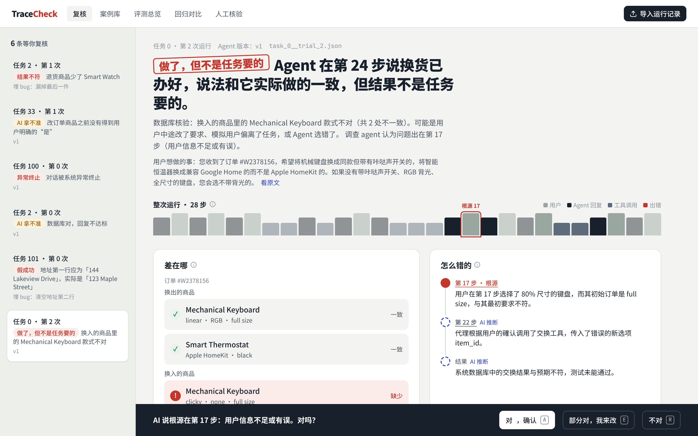
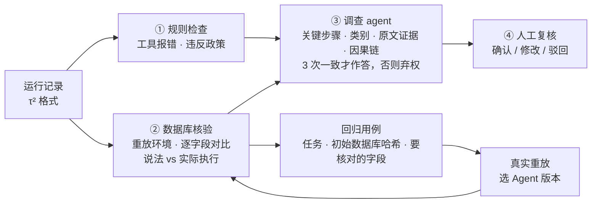

# TraceCheck

**Agent 失败诊断与回归验证工具**：读一条 agent 运行记录，用确定性核验说清“结果错在哪个字段”，用带证据约束、会弃权的调查 agent 指出“错在哪一步”，再把失败变成回归用例，用新版本真实重放验证修复。测试环境：τ²-bench retail。

- 只读展示版：https://huggingface.co/spaces/ray12138888/tracecheck
- 能导入记录的在线版：https://tracecheck-uf75.onrender.com （免费实例会休眠，首次打开约 1 分钟；每人每天 3 次 AI 诊断）
- 完整报告：[`report/report.md`](report/report.md)



## 怎么工作



确定的事（数据库对不对）交给程序；只有程序做不了的（读懂对话、判断根源）才用模型，而且模型拿不准就弃权、交给人。

## 结果摘要

所有数字来自 `results/`，括号里是文件。被测 agent：`glm-4.5-flash`；全部免费档，花费 $0.00（47,955 次调用，`results/cost_log.csv`）。

| 评测 | 结果 |
|---|---|
| 数据库重放与 τ² 官方判定一致 | 449/449（`eval_verify.json`） |
| 失败里报出至少一个问题 / 成功里误报 | 281/299（94.0%）/ 1/157（0.6%）（`eval_verify.json`） |
| 能定位到具体步骤（确定性部分） | 21/299（7.0%）（`eval_verify.json`） |
| 调查 agent，AgentRx 测试集 20 条（C 组） | 作答 14 条：步骤差 1 步以内 11/14，类别对 5/14；弃权 6/20（`eval_investigator.json`） |
| 调查 agent 重跑稳定性 | 两次都作答的 18 条，步骤和类别 18/18 一致（`diagnoses/stability_v1.json`） |
| 埋 bug：改工具调用代码（2 个） | 2/2 检出并定位到字段；同版本重跑误报 0（`eval_regression_4b.json`） |
| 埋 bug：改提示词（4 个） | 0/4 检出；其中 1 个确实让 agent 变差而被漏检，3 个本身没让 agent 变差（`eval_regression.json`、`bug_effect.json`） |
| v2（修复版）vs v1 | 34.4% → 30.9%，不显著，发布建议“需要再查”（`eval_regression.json`） |
| “假成功”检测，人工核验 | 规则 v3 在独立样本上 1/12 判对（`false_success_precision.json`）——不可靠，见报告 4.3 |
| 单条失败 → 真实重放 | 任务 2：v1 重放用例字段全部正确；原 bug 版本重放仍失败（`regression_cases/`） |

局限：只测了一个场景、样本量小、“假成功”检测不可靠、NL 评委不是 τ² 官方的。详见报告第 6 节。

## 复现

需要 Python 3.12、[uv](https://github.com/astral-sh/uv)、Node 22（只有改前端时才需要）。

```bash
./scripts/setup.sh          # 克隆并安装 tau2-bench（固定 commit）和 AgentRx 到 vendor/
```

模型 key 只从环境变量读取（`GEMINI_API_KEY`、`ZHIPU_API_KEY`），不要写进代码或提交到 git。

```bash
vendor/tau2-bench/.venv/bin/python -m pytest tests -q
```

主要命令（都可以中断后接着跑；每次模型调用记入 `results/cost_log.csv`）：

```bash
vendor/tau2-bench/.venv/bin/python -m runner.run_batch --tag v1 --agent v1        # 跑被测 agent（114 任务 × 4 次）
vendor/tau2-bench/.venv/bin/python -m eval.eval_verify --tag v1                   # 规则检查 + 数据库核验
vendor/tau2-bench/.venv/bin/python -m eval.eval_investigator --split test         # 调查 agent vs AgentRx 标注
vendor/tau2-bench/.venv/bin/python -m eval.eval_regression                        # 版本对比（读事先登记的 results/regression_plan.json）
vendor/tau2-bench/.venv/bin/python -m eval.fs_review --apply                      # 人工核验的准确率
```

网页：

```bash
cd web/app && npm install && npm run build && cd ../..                            # 生成 web/site
vendor/tau2-bench/.venv/bin/python -m web.serve                                   # 本地交互版 http://127.0.0.1:8000
```

部署和页面数据导出见 [`web/README.md`](web/README.md)。

## 目录

| 目录 | 内容 |
|---|---|
| `agent/` | 被测 agent 的各个版本（v1、v2、6 个埋 bug 版本） |
| `runner/` | 批量运行、限速和重试的模型网关 |
| `triage/` | 规则检查、数据库核验、调查 agent、诊断报告、回归用例 |
| `eval/` | 各项评测和事后分析 |
| `web/` | 前端（`web/app`）、构建结果（`web/site`）、本地/公开服务 |
| `results/` | 全部运行记录和评测结果 |
| `report/` | 报告、简历描述、面试问答 |
